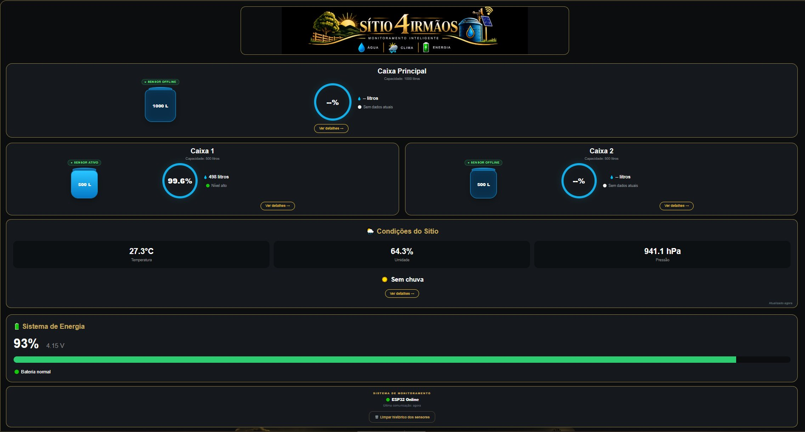
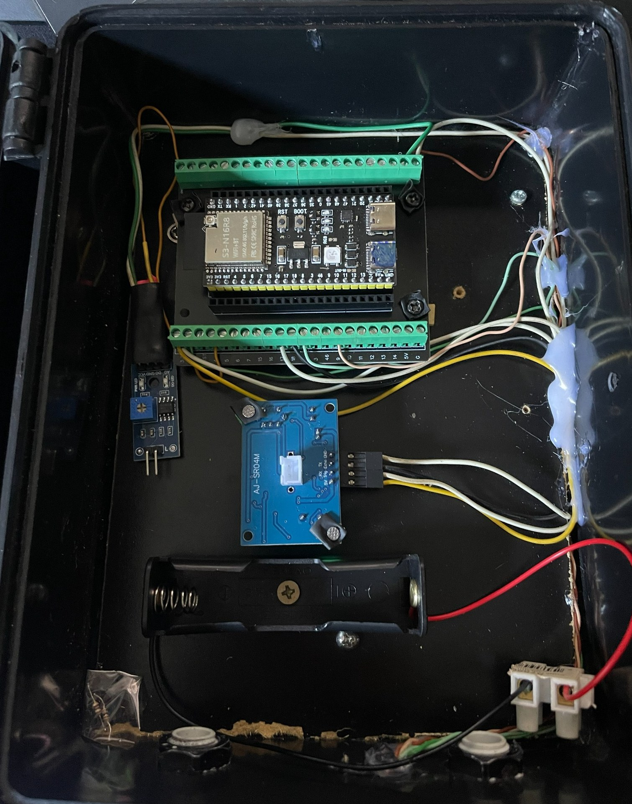
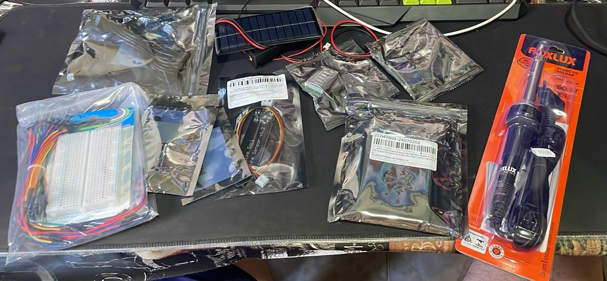

  

# Monitoramento do Sítio 4 Irmãos

Projeto de monitoramento de reservatórios de água com ESP32-S3, sensores ambientais, histórico no Firebase e painel web instalável (PWA). Este repositório é uma versão de demonstração preparada para publicação; as configurações reais foram removidas.

## Recursos

- Leitura de nível e volume da caixa d’água.
- Monitoramento de temperatura, umidade e pressão atmosférica.
- Leitura do sensor de chuva.
- Monitoramento da tensão e estimativa de carga da bateria/UPS.
- Histórico e visualização pelo painel web/PWA.
- Integração opcional com Firebase e notificações Telegram.
- Relógio RTC DS3231 e sincronização de horário pela rede.

## Fotos do projeto

### Painel web (PWA)

Painel com nível e volume das caixas, temperatura, umidade, pressão, status de chuva e estado da bateria. Na captura, apenas a Caixa 1 estava com sensor ativo.

### Caixa eletrônica (ESP32-S3)

ESP32-S3 N16R8 em placa com bornes, módulo do sensor ultrassônico, módulo do sensor de chuva e suporte da bateria 18650, dentro de uma caixa de proteção. Houve mudanças em alguns componentes depois desta foto!!

### Componentes

Componentes do projeto: painel solar, sensor capacitivo de umidade do solo, protoboard, jumpers e ferro de solda.

## Estrutura

- `sitio_4_irmaos_firmware/`: firmware do ESP32-S3.
- `public/`: interface web/PWA e recursos estáticos.
- `functions/`: Firebase Cloud Functions.
- `firebase.json`: configuração de Hosting e Functions.
- `.firebaserc`: modelo de seleção de projeto Firebase.

## Segurança antes de usar

**Não publique credenciais reais.** Os valores de Wi-Fi, Firebase e Telegram no firmware estão vazios. As configurações do Firebase web e o e-mail administrativo foram substituídos por marcadores como `SEU_PROJETO_FIREBASE` e `SEU_EMAIL_ADMIN_AQUI`.

A configuração web do Firebase não deve ser tratada como senha: a segurança depende das regras do Firebase, das configurações de autenticação e das restrições de API. Este pacote não inclui as regras do Realtime Database do seu projeto. **Não conecte este código a um banco real nem faça deploy antes de configurar e testar regras restritivas de leitura/escrita.**

Se credenciais reais já foram publicadas ou compartilhadas, revogue/rotacione as credenciais apropriadas; apagar o valor do arquivo não invalida uma credencial já exposta.

## Configuração do firmware

1. Abra `sitio_4_irmaos_firmware/sitio_4_irmaos_firmware.ino` na Arduino IDE.
2. Preencha localmente as redes Wi-Fi na lista `REDES_WIFI`.
3. Configure `FIREBASE_URL`, `FIREBASE_API_KEY`, `FIREBASE_EMAIL` e `FIREBASE_PASSWORD` com os dados do seu próprio projeto.
4. Configure `TELEGRAM_BOT_TOKEN` e `TELEGRAM_CHAT_ID` somente se quiser habilitar os avisos do Telegram.
5. Não faça commit do arquivo com valores reais. Mantenha uma cópia local e revise `git diff` antes de cada commit.

O firmware usa bibliotecas para AHT20, BMP280, ArduinoJson e DS3231/RTClib, além das bibliotecas padrão do ESP32. Instale as dependências compatíveis na Arduino IDE antes de compilar.

## Configuração do painel web/Firebase

Os valores de configuração do Firebase foram substituídos por marcadores para impedir que o repositório aponte para o banco real. Para executar uma cópia própria, crie um projeto Firebase e substitua os marcadores nos blocos `firebaseConfig` dos seguintes arquivos: 

- `public/index.html`
- `public/firebase-messaging-sw.js`
- `public/js/firebase-sync.js`
- `public/js/clima.js`
- `public/js/clima-detalhes.js`
- `public/js/caixa-detalhes.js`

Preencha também `SEU_EMAIL_ADMIN_AQUI` em `public/index.html` e `functions/index.js` com a conta administrativa da sua própria instalação. Atualize `.firebaserc` para o ID do seu projeto.

Antes de publicar ou implantar: configure Authentication, regras do Realtime Database, domínios autorizados e limites/restrições da API key. Confirme que usuários não autenticados não conseguem ler, apagar ou modificar dados protegidos.

## Firebase Functions

A pasta `functions/` contém a função administrativa de reset do histórico. Ela exige usuário autenticado, e-mail administrativo verificado e regras de acesso corretas no projeto. Teste-a em um ambiente de desenvolvimento antes de implantar.

Para instalar dependências dentro de `functions/`, use `npm ci`. Para servir localmente, consulte a documentação oficial do Firebase CLI e configure o projeto de teste primeiro. `node_modules/` e caches locais foram removidos intencionalmente.

## Não tem exatamente essas peças?

Tudo bem. O projeto é modular: vários sensores são opcionais e os pinos podem ser trocados no início do firmware. Use este repositório como base e adapte para o que você tiver.

## Componentes e materiais utilizados

A lista abaixo documenta os principais componentes previstos no projeto e no firmware. Modelos equivalentes podem funcionar, mas devem ser conferidos antes de montar ou substituir peças.

### Eletrônica

- **1 × ESP32-S3 N16R8**, placa de desenvolvimento com USB-C (44 pinos).
- **3 × sensores ultrassônicos JSN-SR04T/AJ-SR04M**, para medir os níveis das caixas d’água.
- **1 × sensor AHT20**, para temperatura e umidade do ar.
- **1 × sensor BMP280**, para pressão atmosférica.
- **1 × módulo sensor de chuva**, ligado à entrada analógica/digital conforme a versão utilizada.
- **1 × módulo RTC DS3231**, com bateria, para manter o relógio quando a internet estiver indisponível.
- **1 × bateria de lítio 18650 (3,7 V)** usada no conjunto de backup/UPS.
- **1 × divisor resistivo de tensão**, com resistores de **100 kΩ e 10 kΩ**, para medir a tensão da bateria com o ESP32-S3.
- Fonte de alimentação e componentes de proteção adequados à instalação, incluindo fusível e circuito de carregamento/backup compatível.
- Fios, conectores, protoboard ou placa de circuito e caixa de proteção adequados ao ambiente de instalação.

> A fonte, o carregador e a proteção da bateria devem ser compatíveis com a célula utilizada. Não ligue a bateria diretamente ao ESP32 nem carregue uma célula de lítio sem circuito de carga/proteção apropriado.

### Ligações de referência do firmware

| Função | GPIO / ligação |
| --- | --- |
| Caixa 1 — TRIG / ECHO | GPIO 17 / GPIO 18 |
| Caixa 2 — TRIG / ECHO | GPIO 5 / GPIO 6 |
| Caixa Principal — TRIG / ECHO | GPIO 10 / GPIO 11 |
| Sensor de chuva | GPIO 4 |
| AHT20 e BMP280 — I²C | SDA GPIO 8 / SCL GPIO 9 |
| DS3231 — I²C separado (`Wire1`) | SDA GPIO 12 / SCL GPIO 13 |
| Leitura da bateria pelo divisor | GPIO 1 |

O firmware está configurado para caixas de **500 L, 500 L e 1.000 L**, respectivamente. A calibração física depende da altura de instalação dos sensores e das dimensões reais de cada reservatório.

**Atenção elétrica:** confirme a pinagem do módulo que você comprou. Alguns sensores ultrassônicos trabalham com sinal ECHO de 5 V; o ESP32-S3 usa lógica de 3,3 V. Use adaptação/divisor de nível apropriado no ECHO quando necessário e nunca aplique tensão acima do limite permitido nos GPIOs.

### Software e serviços

- Arduino IDE e suporte à placa ESP32-S3.
- Bibliotecas Arduino para AHT20, BMP280, RTC DS3231/RTClib e ArduinoJson, além das bibliotecas usadas pelo firmware.
- Firebase Realtime Database, Hosting e Cloud Functions para armazenamento e painel web.
- Aplicação web instalável (PWA) para consultar os dados.
- Bot do Telegram para notificações, se habilitado.

## Agradecimentos

Este projeto foi idealizado, montado, testado e acompanhado por **Ricardo Zuliani**, com apoio do **ChatGPT (OpenAI)** e do **Claude (Anthropic)** no planejamento, organização do código, diagnóstico de problemas, documentação e preparação da publicação. A montagem física, as decisões finais e os testes no local são de responsabilidade do autor do projeto.

## Publicação

Este repositório contém código-fonte e recursos do projeto, não dados reais de telemetria, credenciais, caches do Firebase ou dependências instaladas. Faça uma última busca por senhas, tokens, e-mails pessoais, endereços IP privados e dados de logs antes de cada publicação.

## Licença

Nenhuma licença de código foi definida neste pacote. Até que uma licença seja adicionada, a publicação pública permite visualizar o repositório, mas não concede automaticamente permissão para reutilizar, modificar ou redistribuir o código.
